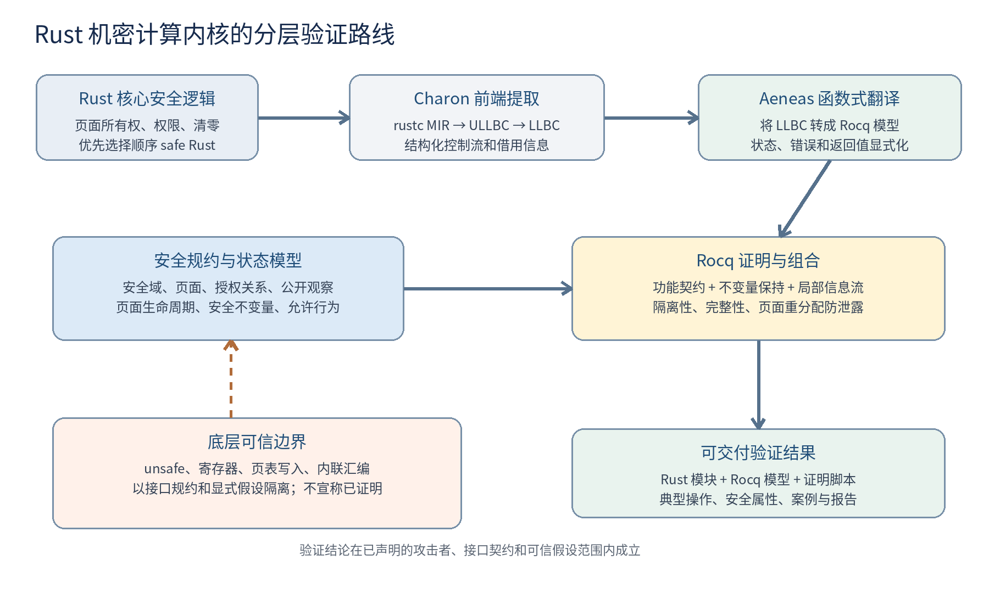

基于 Aeneas 与 Rocq 的 Rust机密计算内核形式化验证方案

研究思路、实施路线、安全属性证明与可验收指标

__验证对象：__机密计算系统 Rust 安全核心    __技术路线：__Charon \+ Aeneas \+ Rocq    __目标：__范围可控、可证明、可验收

| 方案摘要：从 Rust 机密计算内核中剥离可独立验证的安全策略，使用 Charon 提取 LLBC 中间表示，再由 Aeneas 生成 Rocq 函数模型；在 Rocq 中定义页面所有权、授权访问和页面生命周期等规约，证明典型操作满足隔离性、完整性和敏感数据防泄露属性。底层 unsafe、硬件指令及并发机制作为明确记录的可信边界，不纳入第一阶段的不切实际承诺。 |
| --- |

# __1. 研究目标与问题界定__

机密计算内核负责建立和维护不同安全域之间的隔离，例如限制页面访问、管理共享内存、回收物理页面以及处理安全域之间的资源转换。即便代码使用 Rust 编写，所有权与借用检查只能帮助规避部分内存错误，不能自动保证权限判断正确、页面重新分配前已经清零，或敏感状态不会被未授权主体修改。

本方案的目标是对具有代表性的 Rust 安全关键逻辑建立可机器检查的证明，而不是直接承诺验证整个内核、完整硬件平台、全部并发行为或所有侧信道。研究对象限定为可从内核中分离出来的顺序 safe Rust 安全策略及其明确声明的接口假设。

- 验证对象：页面所有权管理、访问权限判断、页面回收与重新分配等核心安全逻辑。
- 证明目标：关键操作符合规约，并保持访问隔离、状态完整性及典型防泄露属性。
- 可信边界：底层 unsafe 封装、硬件操作、未验证外部依赖及工具链假设。
- 交付结果：Rust 示例模块、自动生成的 Rocq 模型、证明脚本与验证报告。

# __2. 相关工作__

## __2.1 Aeneas：把 Rust 程序转换为纯函数模型__

Aeneas 的核心思想是利用 Rust 的所有权和借用规则，把一部分命令式 safe Rust 程序转换为适合定理证明器分析的函数式模型。原程序中的可变更新、借用结束以及返回值处理，会被转换为对数据和状态的显式函数计算，从而减少证明过程中对地址、别名和底层内存布局的重复推理。

对于我们而言，Aeneas 不负责自动证明机密计算安全；它负责把真实 Rust 实现转换成可以在 Rocq 中定义规约、编写定理和检查证明的程序模型。实际安全定理仍然需要针对具体模块进行建模和证明。

## __2.2 Charon：把真实 Rust 项目变成可分析的中间表示__

Charon 对接 Cargo 和 rustc，从 Rust 编译器的 MIR 提取适合分析的中间表示。它首先生成 ULLBC 形式的控制流图，再恢复结构化分支和循环，得到 LLBC。LLBC 保留移动、复制、借用与函数调用等重要语义信息，是 Aeneas 进行函数式翻译的输入。

两者的分工可以概括为：Charon 解决“如何从真实 Rust 项目获得结构化语义表示”，Aeneas 解决“如何把该表示转换为 Rocq 可证明的函数模型”。

| 组成部分 | 主要职责 | 本方案中的产物 |
| --- | --- | --- |
| Rust / rustc | 编译 Rust 安全模块，形成 MIR | 目标 crate 与编译器中间表示 |
| Charon | 提取 MIR，生成 ULLBC 与 LLBC | 结构化的 .llbc 文件 |
| Aeneas | 将 LLBC 函数式化并输出 Coq 后端 | 可在 Rocq 中加载的程序模型 |
| Rocq | 定义安全规约、定理并检查证明 | 形式化模型、证明脚本与结果 |

# __3. 总体技术路线__

验证工作分为两条相互汇合的主线：一条从真实 Rust 安全代码出发，经过 Charon 和 Aeneas 得到 Rocq 函数模型；另一条从安全需求出发，在 Rocq 中建立抽象状态、访问规则和安全属性。最终通过函数级证明把实现模型与安全规约连接起来。

图 1  Rust 机密计算内核安全核心的分层验证路线

1. 选择适合 Aeneas 处理的 safe Rust 安全关键模块，明确模块输入、输出及外部依赖。
2. 使用 Charon 从 Rust crate 中提取 LLBC 中间表示。
3. 使用 Aeneas 的 Coq 后端生成可在 Rocq 中推理的函数式模型。
4. 在 Rocq 中定义安全域、页面状态、授权关系及页面生命周期。
5. 为目标 Rust 函数建立前置条件、后置条件和安全不变量。
6. 证明关键操作保持访问隔离、状态完整性和典型数据防泄露性质。
7. 整理可信假设、证明覆盖范围、复现步骤与验收材料。

# __4. 如何选择验证对象与划分边界__

## __4.1 优先选择可独立验证的安全策略__

验证对象应优先选择结构清晰、状态依赖明确、能够与底层硬件操作分离的 Rust 函数。最合适的首个案例是页面访问和页面重新分配：既能体现机密计算场景中的隔离要求，也能借鉴 VeriSMo 所揭示的页面复用与残留数据风险。

| 候选模块 | 优先证明的属性 | 建议优先级 |
| --- | --- | --- |
| 页面访问检查 | 只有页面所有者或明确授权的主体可以访问 | 第一优先 |
| 页面分配合法性 | 只有空闲页面可以分配，分配后所有者唯一 | 第一优先 |
| 页面回收 | 回收后原主体不再保留访问权限 | 第一优先 |
| 页面重新分配 | 新主体获得页面之前，旧数据已经清零 | 第一优先 |
| 共享授权管理 | 共享仅面向明确授权的目标安全域 | 第二优先 |
| 安全域状态转换 | 状态只按照创建、运行、退出等合法路径变化 | 第二优先 |
| 多核调度与锁 | 并发交错下的锁不变量和状态一致性 | 后续扩展 |

## __4.2 把 safe Rust 与 unsafe 操作分开__

真实机密计算内核不可避免地包含寄存器读写、页表更新、指针解引用和内联汇编。这些操作往往位于 unsafe 代码中，而 Aeneas 当前主要面向顺序 safe Rust。因此，应把安全策略判断与底层执行机制拆成两个层次。

pub fn may\_access(page: &Page, caller: DomainId) \-> bool \{

    page.owner == Some(caller)

        || page.shared\_with.contains(&caller)

\}

pub unsafe fn apply\_page\_mapping(/\* hardware arguments \*/) \{

    /\* trusted low\-level wrapper \*/

\}

第一层 may\_access 属于可验证的安全决策逻辑；第二层 apply\_page\_mapping 属于底层接口。第一阶段证明的是：只有通过授权检查的操作才能被提交给底层接口，并且上层状态更新满足规约。底层接口是否真正正确执行，需要单独验证，或者被列为明确的可信假设。

| 重要限制：不能把“证明 safe Rust 策略正确”表述为“证明整个 Rust 内核、所有 unsafe 代码及硬件实现均正确”。两者之间存在真实的验证边界，结题报告必须如实列出。 |
| --- |

# __5. 在 Rocq 中建立什么模型__

## __5.1 抽象安全状态__

为了让方案可落地，第一阶段不必完整建模 CPU、TLB、嵌套页表及复杂处理器行为。可以先围绕安全策略所直接依赖的信息建立小型抽象状态，包括页面所属安全域、允许共享的主体、页面内容以及页面是否已经清零。

Definition DomainId := nat.

Definition PageId := nat.

Record PageState := \{

  owner       : option DomainId;

  shared\_with : list DomainId;

  contents    : list byte;

  cleared     : bool

\}.

Record KernelState := \{

  pages : PageId \-> option PageState

\}.

上面的代码仅为建模示意；byte、整数范围、错误处理及 Aeneas 实际生成的类型应根据目标 Rust 项目和后端库调整。抽象模型的作用是明确什么状态属于正确行为，而不是重新手写整个内核。

## __5.2 定义安全不变量__

安全不变量描述任何合法状态都应满足的全局约束。对于页面管理案例，可以先选择三条容易解释、适合形成证明闭环的不变量。

- 页面所有权约束：已分配页面必须有明确所有者；空闲页面不能继续保留旧所有者。
- 授权访问约束：页面只能由所有者或共享授权列表中的主体访问。
- 重新分配约束：页面交给新的安全域之前必须完成清零。

Definition authorized (d: DomainId) (p: PageState) : Prop :=

  owner p = Some d \\/ In d (shared\_with p).

Definition valid\_state (s: KernelState) : Prop :=

  unique\_ownership s /\\ valid\_sharing s /\\ reuse\_is\_clean s.

# __6. Rust 代码到 Rocq 模型的处理流程__

建议先创建一个规模较小的 Rust crate，将目标安全策略封装为独立模块，使其能够通过普通 Rust 编译并尽量避免复杂宏、难以处理的外部依赖和不必要的 unsafe 操作。

1. 检查目标 Rust 模块是否能够在固定版本的 rustc 和 Cargo 环境中独立编译。
2. 按 Aeneas 官方推荐方式运行 Charon，生成 .llbc 中间文件。
3. 使用 Aeneas 的 Coq 后端将 .llbc 文件翻译为函数式模型。
4. 将生成的模型加入 Rocq 工程，补充外部类型、库函数及必要的抽象定义。
5. 围绕生成函数撰写规约和定理，使用 Rocq 检查证明。

charon cargo \-\-preset=aeneas

aeneas \-backend coq kernel.llbc

实际文件名由 crate 配置决定；命令中的 kernel.llbc 只是示例。需要固定 Charon、Aeneas、rustc 和 Rocq 版本，并记录外部依赖。Aeneas 官方指出 Coq 是受支持后端之一，但 Lean 与 HOL4 当前更加成熟，因此应尽早对真实目标代码完成一次最小可行性验证。

# __7. 具体证明哪些安全性质__

## __7.1 页面访问隔离__

访问隔离要求安全域不能直接读取其他安全域的私有页面。需要注意，页面被标记为“共享”不应自动意味着任何主体都能访问；合理的规约应检查访问者是否位于明确授权的共享主体集合中。

Theorem access\_check\_sound :

  forall d p,

    may\_access p d = true \->

    authorized d p.

Theorem private\_page\_isolation :

  forall owner\_id caller p,

    owner p = Some owner\_id \->

    caller <> owner\_id \->

    ~ In caller (shared\_with p) \->

    may\_access p caller = false.

该证明能够说明：在所定义的页面状态模型下，未被明确授权的安全域无法通过访问控制逻辑。

## __7.2 关键状态完整性__

完整性要求未授权主体不能通过页面分配、共享配置或回收接口改变受保护状态。对于错误调用，可以选择证明函数返回错误，或者证明其返回的系统状态与调用前保持一致。

Theorem unauthorized\_update\_preserves\_state :

  forall s caller pid s',

    ~ permitted\_to\_update caller pid s \->

    update\_page s caller pid = Ok s' \->

    s' = s.

Theorem successful\_update\_preserves\_invariant :

  forall s caller pid s',

    valid\_state s \->

    update\_page s caller pid = Ok s' \->

    valid\_state s'.

如果实现采用“非法调用返回 Error”的接口设计，则第一条定理应改写为 update\_page s caller pid = Error；具体形式需要与目标 Rust API 保持一致。

## __7.3 页面复用与敏感信息防泄露__

VeriSMo 对本方案最直接的启发，是页面重新绑定或重新分配可能使旧安全域的数据被新安全域读取。对项目结题而言，可以把问题约束为一个具体页面生命周期属性：只有完成清零的页面才允许交给新的所有者。

Theorem reallocation\_requires\_clearing :

  forall s s' pid new\_owner,

    reassign\_page s pid new\_owner = Ok s' \->

    page\_owner s' pid = Some new\_owner \->

    page\_cleared s' pid = true.

Theorem reallocation\_does\_not\_expose\_old\_data :

  forall s s' pid new\_owner,

    reassign\_page s pid new\_owner = Ok s' \->

    page\_contents s' pid = zero\_page.

前者证明页面状态中记录了清零条件，后者进一步证明页面内容确实为零。只有当 clear\_page 的行为本身已验证，或者作为明确的可信接口规约给出时，第二类结论才成立。

# __8. 信息流安全应如何合理落地__

## __8.1 从局部信息流属性开始__

如果项目需要体现信息流安全，可以先对特定函数或执行场景建立局部非干扰属性。定义攻击者能够观察的公开状态，例如公开页面元数据、接口返回码或经过授权的共享信息；再证明私有页面内容的变化不会影响这些公开观察结果。

Definition low\_equiv (s1 s2: KernelState) : Prop :=

  public\_observation s1 = public\_observation s2.

Theorem access\_check\_noninterference :

  forall s1 s2 caller pid,

    low\_equiv s1 s2 \->

    same\_public\_metadata s1 s2 pid \->

    check\_access s1 caller pid =

    check\_access s2 caller pid.

该定理说明：在明确给定的观察模型、页面元数据条件及顺序执行语义下，访问检查不会因为不可见秘密内容的变化而产生不同的公开结果。它属于局部信息流证明，不自动覆盖其他接口、执行时间、缓存侧信道或并发交错。

## __8.2 与完整系统非干扰的区别__

| 证明目标 | 需要处理的内容 | 实施建议 |
| --- | --- | --- |
| 单函数防泄露 | 某个函数的输出不依赖受保护数据 | 可作为第一阶段目标 |
| 页面复用防泄露 | 旧页面内容不会出现在新安全域 | 优先作为典型验证案例 |
| 状态转换局部非干扰 | 给定观察关系时，一次操作保持公开等价 | 在首个案例完成后扩展 |
| 全系统信息流安全 | 所有接口、环境行为、调度和公开事件 | 不建议作为初期结题指标 |
| 时间或缓存侧信道 | 执行时间、访存轨迹和硬件微架构 | 超出本方案第一阶段范围 |

# __9. 对 VeriSMo 的借鉴与取舍__

VeriSMo 将验证分为机器模型层和实现层，并处理恶意环境、硬件状态和安全模块自身的实现安全。我们的 Rust 方案借鉴其“区分安全策略、环境假设与实现证明”的思想，但不照搬完整的硬件和并发证明结构。

- 保留：页面所有权、访问隔离、共享授权和页面生命周期等安全问题。
- 保留：页面重新分配前必须清理旧数据的关键验证案例。
- 保留：明确攻击者能力、可信接口和证明适用范围。
- 简化：暂不构建完整 CPU、TLB、嵌套页表和 RMP 的机器模型。
- 简化：暂不承诺多核并发、任意抢占或全系统非干扰。
- 替换：使用 Charon 与 Aeneas 提取 safe Rust 的 Rocq 模型，而不是使用 Verus 证明整个实现。

| 定位说明：该方案不是对 VeriSMo 完整安全结论的复现，而是将其安全问题分解方法与 Aeneas 的 Rust 函数式翻译结合，形成适合研究项目实施与结题验收的局部形式化验证路线。 |
| --- |

# __10. 推荐的最小验证案例__

建议以页面安全管理模块作为首个完整案例。该案例足够小，便于复现，同时可以同时体现隔离、完整性与敏感信息防泄露。

pub struct Page \{

    pub owner: Option<DomainId>,

    pub shared\_with: Vec<DomainId>,

    pub cleared: bool,

\}

pub fn may\_access(page: &Page, caller: DomainId) \-> bool;

pub fn release\_page(page: &mut Page, caller: DomainId)

    \-> Result<(), Error>;

pub fn reassign\_page(page: &mut Page, new\_owner: DomainId)

    \-> Result<(), Error>;

如果 Vec、外部标准库模型或泛型支持在实际后端中造成阻碍，首版可将共享授权关系简化为固定长度数组、单一授权对象或抽象查询接口。关键是保持安全策略清晰，而不是在原型阶段覆盖全部 Rust 语言特性。

| 目标函数 | 证明内容 | 可提交材料 |
| --- | --- | --- |
| may_access | 只有所有者或授权主体可以访问 | Rust 函数、Rocq 函数和隔离定理 |
| release_page | 未授权主体不能回收页面 | 函数契约、错误分支和完整性证明 |
| reassign_page | 页面只有清零后才能转给新主体 | 页面生命周期规约和防泄露证明 |

# __11. 实施步骤与阶段交付__

| 阶段 | 主要工作 | 完成标志 |
| --- | --- | --- |
| 第一阶段：确定边界 | 梳理 Rust 安全模块、unsafe 调用及外部依赖 | 形成目标函数与可信假设清单 |
| 第二阶段：打通工具 | 固定版本，完成 Charon 提取与 Aeneas Coq 输出 | 生成可加载的 LLBC 和 Rocq 文件 |
| 第三阶段：建立规约 | 定义页面状态、权限关系和页面生命周期 | 形成抽象状态与安全不变量 |
| 第四阶段：证明函数 | 证明访问、回收、重新分配函数满足规约 | 完成不少于 3 项目标操作证明 |
| 第五阶段：证明属性 | 归纳隔离性、完整性或页面防泄露定理 | 完成不少于 2 类典型安全属性 |
| 第六阶段：验收整理 | 整理源码、模型、证明脚本和复现说明 | 形成可复现案例与验证报告 |

# __12. 项目指标与结题建议__

## __12.1 可操作的验收指标__

1. 建立机密计算系统 Rust 核心安全模块形式化模型不少于 1 个。
2. 实现 Rust 安全关键代码向 Rocq 函数式模型的转换。
3. 完成不少于 3 项安全关键函数或操作的形式化分析验证。
4. 完成不少于 2 类典型安全属性验证，例如访问隔离和状态完整性。
5. 形成形式化验证案例、证明代码及分析报告各 1 套。

## __12.2 可直接写入指南的表述__

| 推荐指标：面向机密计算系统 Rust 核心安全模块，建立形式化模型与安全属性规约，实现 Rust 安全关键代码向定理证明模型的转换，完成不少于 3 项安全关键操作及不少于 2 类核心安全属性的形式化分析验证，形成验证案例和验证报告。 |
| --- |

| 更宽松表述：面向机密计算系统 Rust 核心安全模块，开展形式化建模与安全属性分析，实现典型安全关键操作的形式化验证，形成验证案例和验证报告。 |
| --- |

结题时可以用访问权限检查、页面回收和页面重新分配作为三项操作，用访问隔离与页面重新分配防泄露作为两类典型属性。若实际实现条件有限，不建议把全系统非干扰、完整 unsafe 代码验证、多核并发证明、100% 覆盖率或具体代码行数写成刚性指标。

# __13. 风险、假设与不应夸大的结论__

- 工具范围：Aeneas 当前主要针对顺序 safe Rust；unsafe 和并发代码不能直接视为已经验证。
- 后端成熟度：Coq 后端受支持，但官方对 Lean 与 HOL4 的成熟度评价更高，应尽早开展最小可行性测试。
- 外部库：Vec、traits、泛型、外部 crate 以及复杂控制流可能需要简化、补充模型或调整写法。
- 可信接口：页面清零、寄存器访问和页表写入若未单独证明，必须作为显式可信假设。
- 转换可信度：Rocq 检查的是生成模型及其证明；rustc、Charon 和 Aeneas 的执行实现仍应计入工具假设。
- 观察范围：局部信息流定理只覆盖给定的公开观察和顺序语义，不自动覆盖时间、缓存或物理侧信道。
- 环境假设：如果未建模恶意 Hypervisor 的中途干预，则不能宣称对任意环境并发或恶意重映射已经完成证明。

# __14. 总结__

推荐方案可以概括为：从真实 Rust 机密计算内核中提取适合验证的安全核心，借助 Charon 和 Aeneas 将代码转换为 Rocq 函数模型，在 Rocq 中证明页面访问、回收和重新分配等典型操作满足隔离性、完整性及敏感数据防泄露要求。

方案的价值不在于宣称整个系统已经被彻底验证，而在于建立一条可复现、可解释、可扩展的 Rust 实现级形式化验证路线，并通过清晰的可信边界和有限的典型案例形成可验收的研究成果。

# __参考文献与资料__

\[1\] S. Ho and J. Protzenko. Aeneas: Rust Verification by Functional Translation. ICFP 2022. [论文 DOI](https://doi.org/10.1145/3547647)

\[2\] S. Ho et al. Charon: An Analysis Framework for Rust. arXiv:2410.18042v3, 2025. [arXiv 论文](https://arxiv.org/abs/2410.18042)

\[3\] AeneasVerif. Projects: Charon, Aeneas and supported proof backends. [官方项目说明](https://aeneasverif.github.io/projects/)

\[4\] AeneasVerif. Aeneas source repository: usage, limitations and backend support. [官方代码仓库](https://github.com/AeneasVerif/aeneas)

\[5\] Z. Zhou et al. VeriSMo: A Verified Security Module for Confidential VMs. OSDI 2024. [USENIX 论文](https://www.usenix.org/conference/osdi24/presentation/zhou)

