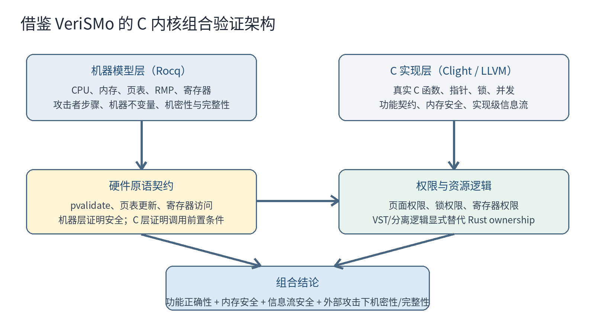

__借鉴 VeriSMo 的 C 内核形式化验证方案__

论文方法归纳、C 语言迁移路线及与原方案的差异

__参考论文：__VeriSMo，OSDI 2024    __目标对象：__TEE Monitor / 安全内核 C 代码    __建议工具：__Rocq \+ CompCert Clight \+ VST

| 结论先行：VeriSMo 最值得借鉴的不是 Rust/Verus 本身，而是“机器模型层 + 实现权限层”的拆分。迁移到 C 后，应使用 Rocq 建模恶意 Hypervisor 和硬件状态，用 CompCert Clight/VST 显式证明指针、页面、锁和寄存器权限，并保留原方案中的接口精化与顶层信息流证明。 |
| --- |

# __1. 论文解决了什么问题__

VeriSMo 是运行在 AMD SEV\-SNP 机密虚拟机内部、处于最高 VMPL 权限级的安全模块。它向 Guest OS 提供代码完整性保护、运行时度量、密钥管理和页面状态切换等安全服务，同时必须防止不可信 Hypervisor 和低权限 Guest OS 读取或篡改自身状态。

论文关注的关键难点是两类并发同时存在：一类是 VeriSMo 自身的多核并发，另一类是恶意 Hypervisor 可以在任意时刻中断 VeriSMo，并修改嵌套页表、RMP 或共享硬件状态。仅使用传统函数级 Hoare Logic，很难直接证明这种环境下的系统安全。

| 验证性质 | 论文中的含义 | 典型错误 |
| --- | --- | --- |
| 功能正确性 | 满足前置条件时，函数返回值与状态满足后置条件 | 密钥生成函数返回常量；页面状态转换遗漏步骤 |
| 安全信息流 | 低安全变量、内存轨迹和控制流不依赖秘密初值 | 秘密写入公开内存；秘密控制分支；秘密作为访问地址 |
| VM机密性 | Hypervisor/VMPL3不能显式读到VMPL0私有数据 | 错误页表/RMP更新把私有页暴露给低权限主体 |
| VM完整性 | 攻击者任意修改后，私有数据仍保持原值或访问失败 | 恶意重映射使安全模块读取被替换的物理页面 |

# __2. 论文的核心：两层验证架构__

论文没有在同一个巨大状态上同时处理硬件、攻击者、软件多核和所有函数细节，而是把验证拆为机器模型层与实现层。两层通过硬件原语的前置条件和后置条件连接。

图 1  从 VeriSMo 两层验证迁移到 C 内核后的总体结构

## __2.1 机器模型层__

机器模型 Ψ 表示 CPU、内存、页表、RMP、系统映射、TLB 和寄存器等硬件资源。模型中的操作由不同实体发起：最高权限安全模块 E0、低权限 Guest OS E3，以及不可信 Hypervisor Ehv。攻击者可以任意组合自己的操作，而 E0 的硬件操作必须满足经过验证的前置条件。

MachineInv(Ψ) /\\ Ψ \-\-\[entity, op\]\-\-> Ψ'

  \-> MachineInv(Ψ').

AttackReachable(Ψ, Ψ') /\\ Ψ' \-\-\[attacker, op\]\-\-> Ψ''

  \-> AttackReachable(Ψ, Ψ'').

通过证明机器不变量和攻击者可达关系对每一种原子操作封闭，论文将安全结论推广到任意长的攻击序列，而不是直接枚举攻击调用序列。

## __2.2 实现验证层__

VeriSMo 的实现层利用 Rust ownership 和 Verus tracked permission，把内存、锁、寄存器等资源表示成不可随意复制的证明权限。只有持有相应权限，程序才能读取、写入或修改硬件属性。权限同时记录资源标识、内容、软件属性和硬件属性，从而把机器模型约束带到实现代码。

- 内存权限：记录地址、值、页表属性、RMP属性和是否为页表页面。
- 锁权限：锁未持有时保存资源权限；获得锁后把资源权限交给当前CPU；释放锁时要求恢复不变量。
- 寄存器权限：区分私有寄存器、Hypervisor可修改的共享寄存器，以及CR3、RIP、SP等危险寄存器。
- 原语权限：pvalidate、rmpadjust和页表写入只有在资源属性满足前置条件时才能调用。

# __3. 机器模型层具体证明了什么__

论文首先把客户机内存划分为 VMPL0 私有、VMPL3 私有和 Hypervisor 共享三类，然后建立五个关键引理支撑顶层机密性与完整性定理。

| 引理 | 核心结论 | 对C内核验证的意义 |
| --- | --- | --- |
| VM私有页绑定 | 攻击者改变嵌套页表后，原GPA仍绑定原SPA或不再绑定 | 不能只看软件页表；必须联合建模反向映射/硬件所有权 |
| Hypervisor机密性 | Hypervisor读取私有页只能得到密文或失败 | 机器级加密属性应进入安全定理，而非仅作为自然语言假设 |
| VMPL0隔离 | 低权限VMPL不能读取VMPL0私有页，VMPL0读取为原值或失败 | 权限授予接口必须禁止把高权限私有页授权给低权限主体 |
| 地址翻译稳定 | 攻击者干扰后，GVA仍翻译到原SPA或访问失败 | 需要同时考虑GVA-GPA与GPA-SPA两级映射 |
| 一一映射 | 可达状态中GVA到SPA保持一一对应 | 页表写入前置条件要保证页表页隔离和映射唯一性 |

# __4. 信息流安全方法__

VeriSMo 没有主要依赖传统双运行非干扰，而是给基础类型增加实际值、攻击者可能值集合和相对实体的安全级别。如果攻击者认为该值可能是类型中的任意值，则其仍为秘密；如果可能值集合只有一个值，则为公开值。

- 算术和逻辑运算同时传播实际值与可能值集合。
- 秘密不能直接参与产生公开控制流的比较。
- 秘密不能作为内存访问地址，否则地址轨迹可能泄露秘密。
- 内存权限中的内容标签必须与页表/RMP提供的机密属性一致。
- 降密通过可信函数完成；降密后的值不能继续满足秘密密钥的使用条件。

| 适用边界：该方案适合秘密种类有限、秘密主要通过可信密码函数使用的安全模块。通用 C 内核中的秘密页面、任意指针和复杂控制流更多，因此安全类型适合做局部自动检查，但不应完全替代顶层双运行或 unwinding 定理。 |
| --- |

# __5. 论文发现的关键漏洞__

论文验证页面从共享状态重新变为私有状态时，发现仅检查软件记录和持锁仍然不够。攻击者可以在两个接口调用之间重新绑定 Guest 物理页和系统物理页，使低权限主体最终获得保存高权限秘密的物理页面。

1. VMPL3请求把GPN3设置为共享，安全模块使页面失效并记录共享状态。
2. 恶意Hypervisor修改嵌套页表和RMP，把GPN3重新绑定到保存VMPL0密钥的SPN0。
3. VMPL3请求把GPN3重新设置为私有。
4. 安全模块错误地假设GPN3仍对应原普通页面，并执行验证和权限授予。
5. VMPL3通过GPN3访问到SPN0中的秘密。

修复方法是在验证页面之后、把访问权限授予VMPL3之前清零页面。这个案例说明：页面生命周期证明必须包含物理页重新绑定和环境并发，而不能只证明单个C函数在顺序执行下更新了正确字段。

# __6. 如何迁移到C内核验证__

机器模型层与实现语言无关，可以直接在 Rocq 中重建。真正需要替换的是实现层：C 没有 Rust ownership，也没有 Verus tracked variable，因此内存安全、别名和权限必须由 CompCert Clight 语义与 VST/分离逻辑显式证明。

## __6.1 Rocq机器模型__

Record MachineState := \{

  mem        : SPA \-> Value;

  npt        : GPA \-> option SPA;

  page\_table : Domain \-> GVA \-> option GPA;

  rmp        : SPA \-> RMPEntry;

  regs       : CPU \-> Register \-> Value;

  tlb        : CPU \-> GVA \-> option SPA

\}.

Inductive machine\_step :

  Entity \-> Operation \-> MachineState \-> MachineState \-> Prop :=

| StepRead | StepWrite | StepPValidate | StepRMPAdjust

| StepNPTUpdate | StepPageTableWrite | StepRegisterWrite.

不可信 Hypervisor 的操作作为环境步骤进入 machine\_step；内核操作则通过硬件包装器契约施加前置条件。这使攻击模型成为证明对象，而不是文档中的自然语言说明。

## __6.2 用VST权限替代Rust权限__

建议把页面、页表项、锁和寄存器表示为分离逻辑资源。写权限保持排他，读权限可按需要使用只读或分数权限。C函数只有在前置条件中获得资源后才能操作对应地址。

Definition page\_rep (p : val) (data : list byte)

    (attr : PageAttr) (label : SecLabel) : mpred :=

  data\_at Tsh page\_struct (encode\_page data attr label) p.

Definition page\_lock\_inv (lk : val) (ps : list PageId) : mpred :=

  EX st, page\_table\_rep ps st \* rmp\_rep ps st \*

         ownership\_unique st \* mapping\_authorized st.

获得锁时取得锁不变量中的页面与映射资源；释放锁时必须恢复所有权唯一、页表/RMP一致和内容标签约束。这比把锁仅建模成locked/unlocked布尔值更强。

## __6.3 硬件原语包装器__

C内核中的内联汇编和特殊指令不应在每个函数证明中反复展开。为pvalidate、rmpadjust、TLB操作和寄存器访问建立统一包装器：机器层证明其契约足以保持安全，实现层证明每个调用点满足契约前置条件。

- 可信实现方案：把少量汇编包装器及其后置条件列入TCB。
- 更强方案：对包装器汇编语义单独验证，再连接到Clight外部调用。
- 工程折中：第一阶段信任包装器，明确统计可信代码行数，后续逐步缩小TCB。

# __7. C版本的信息流安全__

建议采用两级方法。第一层借鉴VeriSMo，在Clight表达式和内存资源上维护安全标签，用于快速排除显式流、秘密地址和明显控制流泄露；第二层保留原方案的双运行/unwinding定理，用于形成最终系统级信息流结论。

Inductive SecLabel :=

| Public

| Secret (owner : Domain)

| Declassified.

- 实现级检查：Secret不能写入Public页面，不能作为公开访存地址。
- 局部控制流检查：秘密控制的分支不能产生不同的公开事件和错误码。
- 顶层关系：两个仅秘密不同的状态执行一步后，对低安全域仍不可区分。
- 显式降密：允许的返回值和共享缓冲区更新必须由策略明确授权。

low\_equiv d s1 s2 \->

step s1 e s1' \-> step s2 e s2' \->

low\_equiv d s1' s2'.

# __8. 与之前方案的差异__

| 比较项 | 之前方案 | 借鉴VeriSMo后的方案 |
| --- | --- | --- |
| 证明中心 | C实现精化抽象TEE接口规约 | 机器安全证明与C权限证明组合；仍保留接口精化 |
| 系统结构 | 平台—抽象TEE—接口规约—C实现四层 | 机器模型层 + C实现权限层，通过硬件原语契约连接 |
| 攻击者 | 主要在威胁模型和抽象环境中描述 | Hypervisor操作直接建模为机器状态转换和可达关系 |
| 并发 | 第一阶段把接口视为原子，并发后续扩展 | 从开始区分外部攻击者并发与内核内部多核并发 |
| 内存证明 | Rep关系把C内存对应到抽象状态 | Rep之外，每个页面/页表/寄存器还携带显式资源权限 |
| 锁证明 | 证明锁保护抽象不变量 | 锁本身持有页面、RMP、页表等证明资源 |
| 信息流 | 抽象层双状态关系和unwinding | 实现级安全类型/值集合 + 顶层unwinding |
| 实现接入 | LLVM-to-Rocq或CompCert Clight | 仍使用Clight/LLVM，但增加VST权限逻辑与原语包装器 |
| 适用代码 | 更偏向已有C代码和接口级精化 | 原论文偏验证友好重写；迁移到遗留C后证明负担明显增加 |
| 可信基 | Rocq、转换器、编译器和硬件抽象 | 增加硬件原语规约、权限库、锁模型和汇编包装器 |

# __9. 两种证明结构的本质区别__

之前方案以抽象规约精化为中心：

C实现 <= 抽象TEE规约

抽象TEE规约 |= Noninterference

\-\-\-\-\-\-\-\-\-\-\-\-\-\-\-\-\-\-\-\-\-\-\-\-\-\-\-\-\-\-\-\-

C实现 |= Noninterference

借鉴VeriSMo以后，安全结论来自两个方向：

机器模型 |= 外部攻击下的机密性与完整性

C实现 |= 功能正确性 \+ 内存权限安全 \+ 实现级信息流

\-\-\-\-\-\-\-\-\-\-\-\-\-\-\-\-\-\-\-\-\-\-\-\-\-\-\-\-\-\-\-\-\-\-\-\-\-\-\-\-\-\-\-\-\-\-\-\-\-\-\-

组合系统 |= TEE内核安全

新方案不是取消抽象规约，而是增加机器环境证明和资源权限证明，使抽象安全结论能够覆盖恶意页表重映射、硬件状态变化和真实C指针访问。

# __10. 推荐的组合方案__

| 推荐技术路线：Rocq机器模型 + CompCert Clight + VST权限证明 + 接口精化 + unwinding信息流证明。机器模型负责恶意Hypervisor和硬件状态，VST负责C指针、锁和资源权限，接口精化负责功能行为，安全标签和unwinding共同负责信息流。 |
| --- |

1. 选择页面私有/共享切换作为首个案例，覆盖delegate、set\_shared、set\_private、reclaim。
2. 在Rocq中定义GVA\-GPA\-SPA、页表、RMP和攻击者环境步骤。
3. 证明机器不变量、地址翻译稳定性和攻击者可达封闭性。
4. 将500\-1500行C代码转为Clight，为页面、锁和页表建立VST谓词。
5. 逐接口证明C实现满足功能规约，并且硬件包装器前置条件始终成立。
6. 增加局部安全标签检查和顶层unwinding证明。
7. 植入重映射、遗漏清零、错误授权和错误码泄露等负面版本，验证工具能否定位反例。

# __11. 分阶段实施与交付物__

| 阶段 | 主要任务 | 完成标志 |
| --- | --- | --- |
| 阶段1：机器模型 | 建模实体、页表、RMP、地址翻译和攻击者操作 | 证明机器不变量及私有页面机密性/完整性 |
| 阶段2：C资源模型 | Clight接入；页面、页表、寄存器和锁的VST谓词 | 所有目标C函数通过内存安全与资源权限检查 |
| 阶段3：接口精化 | delegate/shared/private/reclaim函数契约和表示关系 | 具体执行精化抽象接口规约 |
| 阶段4：信息流 | 安全标签、公开观察、降密策略和unwinding | 证明功能级机密性和完整性 |
| 阶段5：自动化 | 权限模板、路径裁剪、SMT、反例回映射 | 统计自动关闭比例、验证时间和人工注解量 |

# __12. 风险与边界__

- C没有Rust所有权，指针别名、越界、生命周期和未定义行为必须显式证明，成本会明显高于VeriSMo。
- 机器模型正确性依赖AMD/Arm硬件手册和原语规约，模型遗漏会直接削弱安全结论。
- 如果汇编包装器仅用可信后置条件描述，其实现仍属于TCB。
- 实现级安全标签不能独立替代系统级非干扰，尤其不能自动处理所有隐式流和时间侧信道。
- 若C接口被视为原子步骤，证明不覆盖接口执行中途的抢占；后续需要增加线性化点和环境干扰模型。

# __13. 总结__

VeriSMo 对我们最大的启发，是把外部恶意环境和内部程序实现分开验证。机器模型层负责回答“Hypervisor无论怎样修改硬件状态，隔离机制是否仍安全”；实现层负责回答“内核代码是否只在拥有相应权限时访问资源，并正确调用硬件原语”。

对于C内核，最合理的做法不是简单仿照VeriSMo重写一套安全类型，而是以VST/分离逻辑显式重建权限，再与原方案中的抽象接口精化和unwinding证明结合。这样得到的方案工作量更大，但对恶意重映射、并发干扰和真实C内存错误的解释力也更强。

# __参考文献__

\[1\] Z. Zhou et al. “VeriSMo: A Verified Security Module for Confidential VMs.” OSDI 2024. [USENIX](https://www.usenix.org/conference/osdi24/presentation/zhou)

\[2\] A. Lattuada et al. “Verus: A Practical Foundation for Systems Verification.” SOSP 2024. [论文页面](https://verus-lang.github.io/)

\[3\] X. Li et al. “Spoq: Scaling Machine\-Checkable Systems Verification in Coq.” OSDI 2023. [USENIX](https://www.usenix.org/conference/osdi23/presentation/li-xupeng)

\[4\] G. Yang et al. “Spoq2: Highly Automated Verification of Security Properties for Unmodified System Software.” ASPLOS 2026. [论文PDF](https://www.cs.columbia.edu/~nieh/pubs/asplos2026_spoq2.pdf)

\[5\] A. W. Appel. “Verified Software Toolchain.” ESOP 2011 and related VST work. [VST](https://vst.cs.princeton.edu/)

\[6\] R. Leroy. “Formal Verification of a Realistic Compiler.” Communications of the ACM, 2009. [CompCert](https://compcert.org/)

